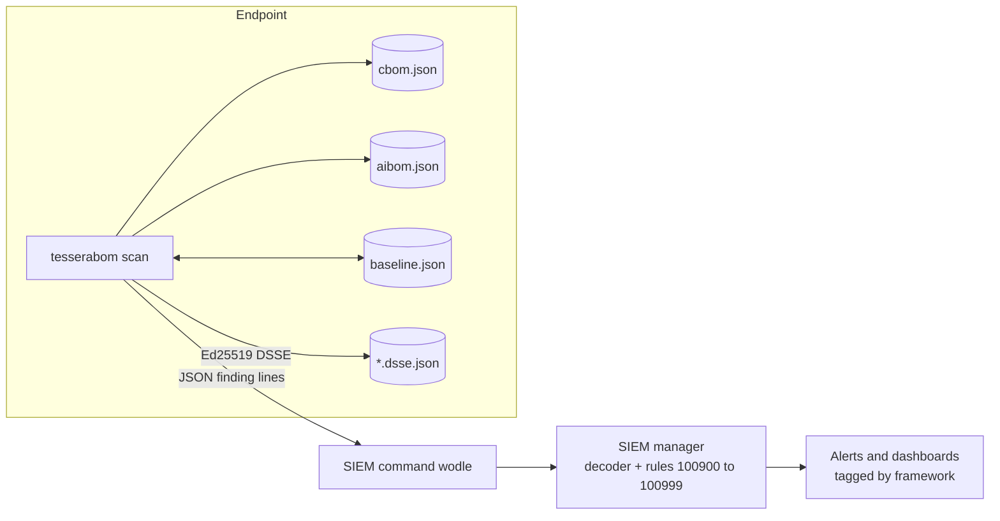

<div align="center">


# tesserabom

### One tile per endpoint. One mosaic of every cipher and every model you run.

Endpoint **CBOM** and **AI-BOM** with baseline **drift and downgrade alerts**, **signed attestations**,
and **SIEM-native rules** that are tested on a real manager.

[](https://github.com/sunilgentyala/tesserabom/actions/workflows/ci.yml)


[Quick start](#quick-start) &nbsp;|&nbsp; [What it finds](#what-it-finds) &nbsp;|&nbsp; [SIEM integration](#siem-integration) &nbsp;|&nbsp; [Security](#security-by-design) &nbsp;|&nbsp; [Honest limits](#honest-limits)

</div>

---

## Why

Auditors and regulators now ask two questions that most endpoint tooling cannot answer: **which cryptography is actually
running here, and how ready is it for post-quantum migration?** and **which AI models and MCP servers are on these machines?**
The SIEM gives you excellent endpoint telemetry, and the 4.14.x release notes searched in November 2026 show no native
cryptographic or AI inventory.

tesserabom is a small, dependency-light collector that fills that gap and reports through the channel the SIEM already
understands: JSON log lines, decoders, rules and compliance tags.

## At a glance

| | |
|---|---|
| **Two BOMs, one run** | CycloneDX 1.6 **CBOM** (certificates, TLS, SSH, libraries) and **AI-BOM** (models, MCP servers, runtimes). Both validated against the official JSON schema in CI. |
| **Drift that matters** | A baseline remembers every asset. Alerts fire on new, removed and changed assets, and on **cryptographic downgrades** such as TLS 1.3 falling to 1.2 or a lost post-quantum hybrid. |
| **Provable output** | Each BOM can be wrapped in a **DSSE** envelope signed with Ed25519, so an inventory can be shown untampered. |
| **SIEM-native** | 19 finding rules, decoders, an agent snippet and compliance tags. Verified with `logtest` on a live manager (release 4.14.10). `pci_dss_12.3.3` lands in the platform's own PCI dashboard field. |
| **Safe to run as root** | No shell, no `PATH` lookups, loopback-only probing, secrets never read, atomic 0600 writes. |

## How it works



## What it finds

<table>
<tr><th width="22%">Collector</th><th>Detail</th></tr>
<tr><td><b>Certificates</b></td><td>X.509 files in standard directories, the Windows certificate stores (<code>MY</code>, <code>ROOT</code>), and the certificate each probed TLS endpoint presents. Records key family and size, signature algorithm, validity, and whether the key is quantum-vulnerable. Malformed certificates are skipped, never fatal.</td></tr>
<tr><td><b>TLS endpoints</b></td><td>Loopback listeners you name. Negotiated protocol version, cipher, key-exchange group, and whether a post-quantum hybrid was negotiated.</td></tr>
<tr><td><b>SSH</b></td><td><code>sshd_config</code> key-exchange settings plus the OpenSSH version, to infer post-quantum key-exchange status.</td></tr>
<tr><td><b>Crypto libraries</b></td><td>OpenSSL version in use and whether it is new enough for ML-KEM (3.5 or later).</td></tr>
<tr><td><b>Local models</b></td><td>GGUF, safetensors, ONNX, PyTorch, pickle and Keras files. Hashed, header checked against the extension, pickle-based formats flagged.</td></tr>
<tr><td><b>MCP servers</b></td><td>Claude Desktop, Claude Code, Cursor, Windsurf and VS Code configs. Flags unpinned <code>npx</code> and <code>uvx</code> packages, cleartext remote URLs, and credentials kept in config files. Only key names are read, never values.</td></tr>
<tr><td><b>AI runtimes</b></td><td>Local Ollama and LM Studio listeners, and an Ollama configured to listen beyond loopback.</td></tr>
</table>

<details>
<summary><b>All 19 findings and their severity</b></summary>

| Finding | Severity | Area |
|---|---|---|
| `cert_expired`, `cert_weak_signature`, `cert_weak_key` | high (`cert_weak_key` is medium on self-signed roots) | Certificates |
| `cert_expiring` | medium | Certificates |
| `tls_legacy_version` | high | TLS |
| `tls_no_pq_hybrid`, `ssh_no_pq_kex` | info | Post-quantum readiness |
| `crypto_downgrade` | high | Drift |
| `drift_changed` | medium | Drift |
| `drift_added`, `drift_removed` | info (medium for models, MCP servers, runtimes) | Drift |
| `model_header_mismatch`, `mcp_cleartext_remote`, `ai_runtime_exposed` | high | AI |
| `model_unsafe_serialization`, `mcp_unpinned_package`, `mcp_secret_in_config` | medium | AI |
| `mcp_remote_server`, `ai_runtime_present` | info | AI |

</details>

## Quick start

```bash
pip install .                      # Python 3.9+; the only dependency is the cryptography package

tesserabom keygen --dir /etc/tesserabom                 # once per fleet or host
tesserabom scan \
  --out /var/lib/tesserabom/out \
  --baseline /var/lib/tesserabom/baseline.json \
  --sign-key /etc/tesserabom/tesserabom-signing.key \
  --tls-port 443 --tls-port 8443

tesserabom verify /var/lib/tesserabom/out/cbom.dsse.json --pub /etc/tesserabom/tesserabom-signing.pub
tesserabom diff old/cbom.json new/cbom.json            # what changed between two hosts or two scans
```

Useful options: `--cert-dir`, `--model-dir`, `--mcp-config` (each replaces the defaults), `--all-users` (inspect every user
home; needed when the agent runs as root or SYSTEM), `--hash-limit-mb`, `--no-update-baseline`, `--skip-crypto`, `--skip-ai`.

A finding, as the SIEM receives it:

```json
{"tesserabom":{"event":"finding","host":"web01","tool_version":"0.3.0","finding":"crypto_downgrade","severity":"high","asset":"tls:127.0.0.1:443","detail":"TLS version dropped from TLSv1.3 to TLSv1.2"}}
```

## SIEM integration

1. Copy `siem/decoders/tesserabom_decoders.xml` and `siem/rules/tesserabom_rules.xml` to the manager's `etc/decoders/`
   and `etc/rules/`, then restart the manager.
2. Add `siem/agent/ossec-agent-snippet.xml` to the agent configuration. It runs a scan every 12 hours through the
   command wodle. Depending on your SIEM version, centrally pushed command wodles may need remote commands enabled.
3. Test offline with `logtest` (lines in `siem/samples/logtest.txt`) or run `scripts/logtest_docker.sh`.

> **Tested on a real manager.** `scripts/logtest_docker.sh` starts a a 4.14.10 manager container, loads the content, and
> asserts the rule that fires for each sample. It caught two bugs unit tests could not. The command wodle delivers
> the raw JSON line (verified on a live manager: location `command_tesserabom`, decoded by the SIEM's built-in `json`
> decoder), so the rules anchor on the decoded `tesserabom.event` field. `<localfile>` command collection instead
> wraps lines as `ossec: output: 'tag': ...`, which the SIEM's built-in `ossec` decoder claims first, so a small child
> decoder handles that form. Not yet covered: a remote agent reporting to a separate manager, and the 5.x series.

### Compliance tags

Tags are lookup aids for dashboards, **not statements of compliance**.

| Findings | Tags |
|---|---|
| Certificates, TLS, SSH, downgrade | `pci_dss_12.3.3`, `dora_rts_2024_1774_art6`, `dora_rts_2024_1774_art7`, `nydfs_500.15`, `pqc_readiness`, `crypto_agility` |
| AI models, MCP servers, runtimes, drift | `dora_art8_4`, `nydfs_500.13`, `ai_bom`, `mcp`, `drift` |

How well each reference was verified is recorded in [docs/STANDARDS-STATUS.md](docs/STANDARDS-STATUS.md). The PCI DSS
12.3.3 wording is corroborated by several sources but the PCI SSC document could not be fetched, so quote the official
text in audit evidence. Licensing context is in [docs/LICENSING-NOTES.md](docs/LICENSING-NOTES.md).

## How it differs

The neighbours below were found in a November 2026 search. The search was broad but not exhaustive, so read this as
"to our knowledge, no open-source project found combines all five of: endpoint collection, CBOM plus AI-BOM, a
baseline with downgrade detection, signed attestations, and SIEM-native rules", not as a claim to be first.

| Project | Overlaps | What it does not do |
|---|---|---|
| [CBOMkit](https://github.com/cbomkit/cbomkit) and Sonar Cryptography | CycloneDX CBOM | Scans source code and container images, not live endpoints. No AI-BOM, drift, signing or SIEM content. |
| [cdxgen](https://github.com/cdxgen/cdxgen) | CycloneDX BOMs, MCP and model discovery in build-time scans | A build-time generator, not a continuous endpoint monitor. No SIEM content. |
| [AC-Scanner](https://github.com/qubitac/AC-Scanner) | CBOM with run-to-run comparison | Remote network scanner under AGPL-3.0. No AI-BOM, signing or SIEM. |
| [Trusera ai-bom](https://github.com/Trusera/ai-bom), [agent-bom](https://github.com/msaad00/agent-bom) | AI-BOM from model files and MCP configs | No CBOM, no SIEM content, no signed BOMs. |
| Community shadow-AI rules | SIEM rules for unapproved AI use | Detection only: no BOM output, no CBOM, no signing. |
| [sbom-tools](https://github.com/sbom-tool/sbom-tools) | Diffs and grades SBOM, CBOM and AI-BOM | Consumes BOMs rather than collecting them. |
| OPSWAT MetaDefender CBOM and AIBOM (commercial) | CBOM plus AI model metadata | File scanning rather than an endpoint collector, per its launch article. |

An independent code comparison against cbomkit, sonar-cryptography, Snyk agent-scan, cdxgen, osquery, sslyze and
ssh-audit found no copied or near-duplicate code. The overlaps are standards-driven: CycloneDX field names, the DSSE
encoding, OpenSSH algorithm names and MCP client config paths. It did not read upstream trees line by line and did
not use a commercial clone detector.

## Security by design

The collector often runs as root, so it is built to be a poor attack target: no shell, no `PATH` lookups, loopback-only
probing, size and depth caps, no symlink following, secret values never read, atomic 0600 writes, and refusal to use
group-readable signing keys. The threat model is in [SECURITY.md](SECURITY.md). CI runs bandit and pip-audit alongside
the tests on Linux and Windows.

## Honest limits

- Post-quantum status for TLS depends on what the probing client can negotiate. If it cannot report the group, the
  result is "unknown" and no finding is raised.
- SSH status uses the effective `sshd -T` configuration only when run as root; otherwise it falls back to reading
  `sshd_config`, which can miss `Include` files and defaults. The version comes from the `ssh` client binary as a
  stand-in for `sshd`.
- MCP checks read configuration only. tesserabom never launches MCP servers, so it cannot see a server changing the
  tool descriptions it advertises after approval. It pins the configured launch spec instead.
- `hndl_exposure` in the summary line is a transparent prioritisation heuristic, not a validated risk model.
- Attestations use Ed25519, a classical signature. They prove integrity today and are not post-quantum.
- Windows SSH and macOS paths get less testing than Linux and the Windows certificate stores.
- the 5.x series (still a release candidate when this was written) and a full agent-to-manager run are untested.

## Roadmap

- [x] CBOM and AI-BOM diff (`tesserabom diff`)
- [x] Effective SSH configuration via `sshd -T`
- [ ] Passive TLS observation from Zeek or Suricata logs (needs a spike to confirm the negotiated group is logged)
- [ ] Agent skill and tool-description inventory with integrity pinning
- [ ] SPDX 3.0 AI profile and CycloneDX 1.7 export
- [ ] Post-quantum attestation signatures
- [ ] the 5.x series content pack
- [ ] Dashboard pack for the SIEM indexer

## Development

```bash
pip install -e ".[dev]"
python -m pytest -q
bash scripts/logtest_docker.sh        # needs Docker; verifies the rules on a real SIEM manager
# Schema validation needs CYCLONEDX_SCHEMA_DIR pointing at bom-1.6.schema.json, spdx.schema.json and
# jsf-0.82.schema.json from github.com/CycloneDX/specification (tag 1.6, schema/)
```

## License

Apache-2.0. See [LICENSE](LICENSE).
