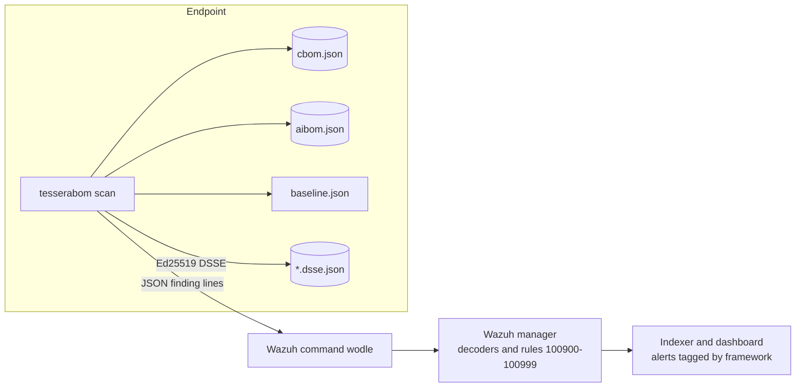

<div align="center">

# tesserabom

**Know which cryptography and which AI is actually running on your endpoints, and get alerted the moment it drifts.**


</div>

---

## Why this exists

Wazuh gives you strong endpoint telemetry, but as of the documentation and release notes reviewed in November 2026 it has no
native view of **cryptographic assets** (certificates, TLS and SSH posture, post-quantum readiness) or **AI assets**
(local models, runtimes, MCP servers). Regulators and auditors increasingly ask for exactly those inventories, and
post-quantum migration cannot be planned without one.

This add-on fills that gap with one small, dependency-light endpoint collector that:

- produces a **CycloneDX 1.6 CBOM** and a **CycloneDX 1.6 AI-BOM**, both validated against the official JSON schema,
- turns every finding into a **Wazuh-ready JSON log line** with decoders and rules included,
- remembers a **baseline** and alerts on **cryptographic downgrades** and configuration drift, not just first-time findings,
- signs each BOM as a **DSSE attestation** so an inventory can be proven untampered,
- keeps secrets out: MCP credentials are never read, only the names of the keys that hold them.

## How it works



| Collector | What it finds |
|---|---|
| **Certificates** | X.509 files in standard directories, the Windows certificate stores (`MY`, `ROOT`), and the certificate each probed TLS endpoint presents. Records key family and size, signature algorithm, validity, and whether the key is quantum-vulnerable. |
| **TLS endpoints** | Loopback listeners you name. Records negotiated protocol version, cipher, key-exchange group, and whether a post-quantum hybrid was negotiated. |
| **SSH** | `sshd_config` key-exchange settings plus the OpenSSH version, to infer post-quantum key-exchange status. |
| **Crypto libraries** | OpenSSL version in use and whether it is new enough for ML-KEM. |
| **Local models** | GGUF, safetensors, ONNX, PyTorch, pickle, Keras files. Hashes them, checks the header against the extension, flags pickle-based formats. |
| **MCP servers** | Configs for Claude Desktop, Claude Code, Cursor, Windsurf and VS Code. Flags unpinned `npx`/`uvx` packages, cleartext remote URLs, and credentials kept in config files. |
| **AI runtimes** | Local Ollama and LM Studio listeners, and an Ollama configured to listen beyond loopback. |

## Quick start

```bash
pip install .                       # requires Python 3.9+ and the cryptography package

tesserabom keygen --dir /etc/tesserabom          # once per fleet or per host
tesserabom scan \
  --out /var/lib/tesserabom/out \
  --baseline /var/lib/tesserabom/baseline.json \
  --sign-key /etc/tesserabom/tesserabom-signing.key \
  --tls-port 443 --tls-port 8443

tesserabom verify /var/lib/tesserabom/out/cbom.dsse.json --pub /etc/tesserabom/tesserabom-signing.pub
```

Useful options: `--cert-dir`, `--model-dir`, `--mcp-config` (each replaces the defaults), `--all-users` (inspect every
user home, needed when the agent runs as root or SYSTEM), `--hash-limit-mb`, `--no-update-baseline`, `--skip-crypto`, `--skip-ai`.

Example output line:

```json
{"tesserabom":{"event":"finding","host":"web01","tool_version":"0.2.0","finding":"crypto_downgrade","severity":"high","asset":"tls:127.0.0.1:443","detail":"TLS version dropped from TLSv1.3 to TLSv1.2"}}
```

## Wazuh integration

1. Copy `wazuh/decoders/tesserabom_decoders.xml` and `wazuh/rules/tesserabom_rules.xml` to the manager's
   `etc/decoders/` and `etc/rules/`, then restart the manager.
2. Add `wazuh/agent/ossec-agent-snippet.xml` to the agent configuration. It runs the scan every 12 hours through the
   command wodle. Depending on your Wazuh version, agents may need remote commands enabled for centrally pushed
   command wodles; check the Wazuh documentation for your release.
3. Test offline with `wazuh-logtest` (paste the lines from `wazuh/samples/logtest.txt`) or run `scripts/logtest_docker.sh`.

> **Tested against Wazuh 4.14.10.** `scripts/logtest_docker.sh` starts a real Wazuh manager container, loads the
> decoders and rules, and runs every line in `wazuh/samples/logtest.txt` through `wazuh-logtest`, asserting the rule
> that fires. It found and fixed two real problems that unit tests could not: Wazuh's built-in `ossec` decoder claims
> command-wodle lines first, and bare JSON lines are decoded by the built-in `json` decoder. What is **not** yet
> covered is a full agent-to-manager run through the command wodle, and Wazuh 5.x (still a release candidate when
> this was written).

The command-wodle approach keeps the add-on a separate process that talks to Wazuh only through logs. It contains no
Wazuh code or data files. See [docs/LICENSING-NOTES.md](docs/LICENSING-NOTES.md) for how that relates to Wazuh's own
license terms. That is a design intent, not legal advice.

### Alerts and compliance tags

Each rule carries group tags you can filter on in the dashboard. They are lookup aids, not statements of compliance.
Wazuh promotes the `pci_dss_` tag into its native `rule.pci_dss` field (verified with `wazuh-logtest`), so these alerts
also appear in Wazuh's built-in PCI DSS dashboard.

| Findings | Tags |
|---|---|
| Certificates, TLS, SSH, downgrade | `pci_dss_12.3.3`, `dora_rts_2024_1774_art6`, `dora_rts_2024_1774_art7`, `nydfs_500.15`, `pqc_readiness`, `crypto_agility` |
| AI models, MCP servers, runtimes, drift | `dora_art8_4`, `nydfs_500.13`, `ai_bom`, `mcp`, `drift` |

How well each reference was verified is recorded in [docs/STANDARDS-STATUS.md](docs/STANDARDS-STATUS.md). The PCI DSS
12.3.3 wording is corroborated by several sources but the PCI SSC document itself could not be fetched, so quote the
official text, not this README, in audit evidence.

## Security by design

The collector often runs as root, so it is built to be a poor attack target: no shell, no `PATH` lookups, loopback-only
probing, size and depth caps, no symlink following, secret values never read, atomic 0600 writes, and refusal to use
group-readable signing keys. Details and the threat model are in [SECURITY.md](SECURITY.md). CI runs bandit and
pip-audit alongside the tests.

## Known limits

- Post-quantum status for TLS depends on what the probing client can negotiate. If it cannot report the group, the
  result is "unknown" and no finding is raised.
- SSH status is inferred from config and the OpenSSH version, not read from the running daemon, and the version comes
  from the `ssh` client binary as a stand-in for `sshd`.
- `hndl_exposure` in the summary line is a transparent prioritisation heuristic, not a validated risk model.
- Attestations use Ed25519, a classical signature. They prove integrity today and are not post-quantum.
- Windows SSH configuration and macOS paths are supported on a best-effort basis and have had less testing than Linux
  and Windows certificate stores.

## Roadmap

- Native ML-KEM and ML-DSA certificate detection as library support lands
- SPDX 3.0 AI profile export
- Post-quantum attestation signatures
- Dashboard pack for the Wazuh indexer
- Passive TLS observation to complement loopback probing

## Development

```bash
pip install -e ".[dev]"
python -m pytest -q
# Validate BOM output against the official schema:
#   point CYCLONEDX_SCHEMA_DIR at a directory holding bom-1.6.schema.json, spdx.schema.json, jsf-0.82.schema.json
#   from github.com/CycloneDX/specification (tag 1.6, schema/)
```

## License

Apache-2.0. See [LICENSE](LICENSE).
